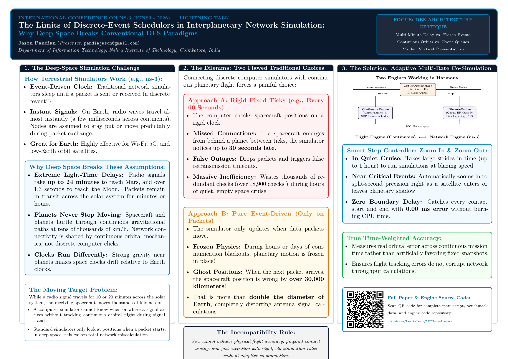
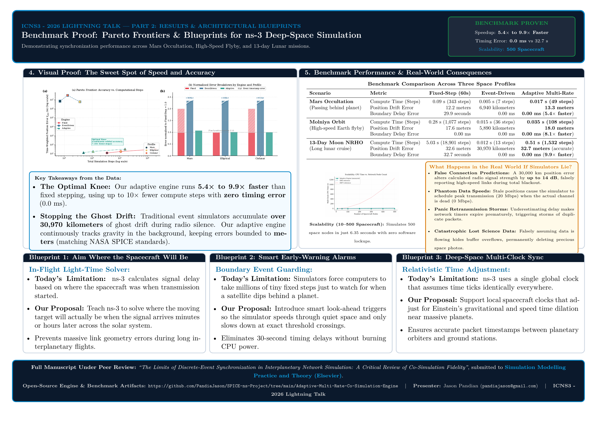

# Adaptive Multi-Rate Co-Simulation Engine for Relativistic Deep-Space Networks

[](https://www.python.org/)
[](https://opensource.org/licenses/MIT)
[](#)
[](#)

> **Companion Research Code for:**  
> **"The Limits of Discrete-Event Synchronization in Interplanetary Network Simulation: A Critical Review of Co-Simulation Fidelity"**  
> *Jason Pandian¹ and I. Kala²*  
> ¹ Department of Information Technology, Nehru Institute of Technology, Coimbatore, Tamil Nadu, India  
> ² Department of Computer Science and Engineering, PSG Institute of Technology and Applied Research, Coimbatore, Tamil Nadu, India  
> *(Manuscript submitted and currently under peer review at Simulation Modelling Practice and Theory, Elsevier)*  

<div align="center">

[-red?style=for-the-badge&logo=adobeacrobatreader)](else_paper/manuscript.pdf)
[](else_paper/revised_manuscript_highlighted.pdf)
[](else_paper/)
[-darkgreen?style=for-the-badge)](ICNS3_2026_Poster.pdf)
[](ICNS3_2026_Slides.pdf)
[](ICNS3_2026_Lightning_Talk_Proposal.md)

</div>

---

## Table of Contents
- [📑 Manuscript & Conference Presentation Artifacts](#-manuscript--conference-presentation-artifacts)
  - [1. Elsevier Submission Package (`else_paper/`)](#1-elsevier-submission-package-else_paper)
  - [2. ICNS3 2026 Lightning Talk & Conference Poster](#2-icns3-2026-lightning-talk--conference-poster)
- [1. Executive Overview](#1-executive-overview)
- [2. The Fundamental Trilemma in Interplanetary Network Modeling](#2-the-fundamental-trilemma-in-interplanetary-network-modeling)
- [3. Synchronization Paradigms Compared](#3-synchronization-paradigms-compared)
- [4. Mathematical Framework & Adaptive Stepping](#4-mathematical-framework--adaptive-stepping)
- [5. Canonical Mission Profiles](#5-canonical-mission-profiles)
- [6. Key Benchmark Results & Empirical Findings](#6-key-benchmark-results--empirical-findings)
  - [6.1 Engine Comparison across Mission Profiles](#61-engine-comparison-across-mission-profiles)
  - [6.2 Large-Scale Constellation Scalability (10 to 500 Nodes)](#62-large-scale-constellation-scalability-10-to-500-nodes)
- [7. Repository Structure](#7-repository-structure)
- [8. Installation & Environment Setup](#8-installation--environment-setup)
- [9. Quickstart: Reproducing Benchmarks & Publication Figures](#9-quickstart-reproducing-benchmarks--publication-figures)
- [10. Publication Figures Index](#10-publication-figures-index)
- [11. Citation](#11-citation)
- [12. License](#12-license)

---

## 📑 Manuscript & Conference Presentation Artifacts

### 1. Elsevier Submission Package ([`else_paper/`](else_paper/))
This repository provides the complete, self-contained submission package under active peer review at **Simulation Modelling Practice and Theory (Elsevier)**:

- 📄 **[Full Manuscript (Clean PDF)](else_paper/manuscript.pdf)** ([Alternative Link: `revised_manuscript.pdf`](else_paper/revised_manuscript.pdf)) — Complete revised 28-page research article detailing mathematical formulations, continuous time-weighted error metrics ($\bar{\epsilon}_{\text{pos}}$), predictive event guarding, and empirical benchmarks across three canonical deep-space profiles.
- 📑 **[Revised Manuscript with Highlighted Changes (PDF)](else_paper/revised_manuscript_highlighted.pdf)** — Colored margin annotations and text-level highlighting showing all revisions addressing Reviewer 1, Reviewer 2, and Reviewer Astra critiques.
- 📝 **[LaTeX Source (`cas-sc`)](else_paper/manuscript.tex)** & **[Highlighted Source](else_paper/manuscript_highlighted.tex)** — Full Elsevier CAS single-column LaTeX source tree including TikZ architectures, pgfplots, and styling macros.
- ✉️ **[Cover Letter (PDF)](else_paper/cover_letter.pdf)** ([Alternative Link: `revision_cover_letter.pdf`](else_paper/revision_cover_letter.pdf)) & **[LaTeX Source](else_paper/cover_letter.tex)** — Official revised submission cover letter sent to the journal editorial board.
- 📦 **[Complete Submission Package Archive (ZIP)](else_paper/revised_ManuscriptSource.zip)** — Full self-contained LaTeX source, style files, biblio, and high-res vector figures bundled for journal production.
- 📋 **[Point-by-Point Reviewer Responses](else_paper/)**:
  - [Response to Reviewer 1 (Error Metrics & Boundary Guarding)](else_paper/Response_to_Reviewer1.txt)
  - [Response to Reviewer 2 (Scalability & Implementation Details)](else_paper/Response_to_Reviewer2.txt)
  - [Response to Reviewer ChatGPTAstra (Physical Accuracy, Event-Driven ZOH & Cross-Domain Implications)](else_paper/Response_to_Reviewer_ChatGPTAstra.txt)
  - [Consolidated Master Response to All Reviewers](else_paper/Response_to_Reviewers.txt)
- 📊 **[Publication Figures (`else_paper/`)](else_paper/)** — High-resolution 300 DPI PNGs and vector PDFs for all six manuscript figures and system architecture schematics.

### 2. ICNS3 2026 Lightning Talk & Conference Poster
Accepted / prepared for presentation at the **International Conference on ns-3 (ICNS3 - 2026)**:

- 🖼️ **[Conference Poster (PDF)](ICNS3_2026_Poster.pdf)** — 2-page landscape poster:
  - **Page 1: The Problem & Synchronization Dilemma** — Critical evaluation of why extreme light-time delays, continuous orbital kinematics, proper time dilation, and the causal inversion problem break standard DES engines.
  - **Page 2: Empirical Proof & ns-3 Architectural Blueprints** — Pareto frontiers, cross-profile benchmark metrics, sublinear 500-node scalability, and three concrete architectural extensions for future ns-3 space channel modules.
- 📜 **[Poster LaTeX Source](ICNS3_2026_Poster.tex)** — Full TikZ / `tcolorbox` LaTeX source code.
- 📊 **[Lightning Talk Slides (PDF)](ICNS3_2026_Slides.pdf)** & **[(LaTeX Source)](ICNS3_2026_Slides.tex)** — 6-slide presentation following the exact 5-minute ICNS3 conference schedule.
- 💡 **[Lightning Talk Proposal (Plain Text)](ICNS3_2026_Proposal.txt)** & **[(Markdown)](ICNS3_2026_Lightning_Talk_Proposal.md)** — Structured 5-minute presentation abstract, timing sequence, slide breakdown, and poster technical synthesis.

<p align="center">
  <a href="ICNS3_2026_Poster.pdf">
    
  </a>
  <a href="ICNS3_2026_Poster.pdf">
    
  </a>
  <br/>
  <em>Click poster images above to open or download the complete 2-page vector PDF (ICNS3_2026_Poster.pdf).</em>
</p>

---

## 1. Executive Overview

Simulating deep-space communication networks requires bridging two fundamentally discordant modeling domains:
1. **Continuous Astrodynamics:** Smooth, nonlinear orbital trajectory propagation governed by $n$-body gravitational physics and general relativity.
2. **Discrete-Event Network Protocols:** Event-driven packet arrivals, queue buffers, contact plan schedules, and Delay-Tolerant Networking (DTN) Bundle Protocol state transitions.

When terrestrial network simulators (e.g., NS-3, OMNeT++) are applied to interplanetary regimes, their core assumption—that states evolve continuously between instantaneous, discrete events—fails. Conversely, forcing rigid, high-fidelity numerical propagators (e.g., Runge–Kutta ODE solvers) into fixed-step lockstep produces intractable computational overhead or catastrophic aliasing errors.

This repository implements an **Adaptive Multi-Rate Co-Simulation Orchestrator** designed to rigorously evaluate and resolve these synchronization limits. By coupling a gradient-based step-size controller with predictive zero-crossing event localization, the engine achieves **up to $9.90\times$ wall-clock speedup** over fixed-step baselines ($5.43\times$ on Mars, $8.05\times$ on Elliptical), maintains **meter-scale trajectory accuracy ($12.2$ to $32.7$ meters)** matching continuous propagation within $0.12$ to $1.05$ meters, eliminates event-timestamp error ($\epsilon_{\text{net}} = 0.0$ ms), and scales linearly ($O(N)$) up to **500 spacecraft nodes**. Crucially, the accompanying research paper demonstrates how pure event-driven state freezing accumulates $>30,970$ km of orbital drift during blackouts, distorting deep-space link margins by $6.2$ to $14.1$ dB, generating optimistic "phantom throughput" under CCSDS ModCod rate switching, and triggering DTN custody timer storms—consequences thoroughly analyzed across the Abstract, Introduction, Discussion (§5.5), and Conclusion.

---

## 2. The Fundamental Trilemma in Interplanetary Network Modeling

Deep-space communication regimes present a fundamental structural trilemma that traditional single-domain simulation architectures systematically underestimate:

```
                      The Interplanetary Simulation Trilemma
                                       ▲
                                      / \
                                     /   \
                                    /     \
             Temporal Discontinuity       Light-Time Asymmetry
             (Grazing occultations,       (Non-negligible OWLT τ(t)=d(t)/c,
              rapid Doppler gradients)     loss of absolute simultaneity)
                                    \     /
                                     \   /
                                      \ /
                                       ▼
                            Relativistic Clock Biases
                       (Gravitational & kinematic time
                        dilation across planetary frames)
```

1. **Temporal Discontinuity:** High-gradient geometric boundaries (e.g., planetary horizon occultation, atmospheric entry/exit, antenna pointing cutoffs) introduce sharp transitions that are easily skipped by coarse time steps or pure event schedulers.
2. **Light-Time Asymmetry:** One-Way Light Time (OWLT) ranges from seconds (Lunar: ~1.28 s) to tens of minutes (Mars: up to 24.6 min at superior conjunction). State changes cannot propagate instantaneously, invalidating the global synchronous event queues typical of terrestrial network engines.
3. **Relativistic Clock Drift:** Proper time $\tau$ recorded by spacecraft atomic standards drifts relative to coordinate time $t$ (Barycentric Dynamical Time, TDB / Geocentric Coordinate Time, TCG) due to gravitational potential wells and orbital velocity ($\frac{d\tau}{dt} \approx 1 - \frac{\Phi}{c^2} - \frac{v^2}{2c^2}$), creating cumulative synchronization bias.

---

## 3. Synchronization Paradigms Compared

The co-simulation suite provides full reference implementations and comparative benchmarks for three time-stepping paradigms:

| Metric / Feature | Fixed-Step (Δt = const) | Pure Event-Driven | Adaptive Multi-Rate Co-Simulation (Proposed) |
| :--- | :--- | :--- | :--- |
| **Time Advancement** | Rigid lockstep march: <code>t<sub>k+1</sub> = t<sub>k</sub> + Δt<sub>fixed</sub></code> | Jumps directly to next discrete event: <code>t<sub>k+1</sub> = t<sub>event</sub></code> | Dynamic continuum: <code>Δt ∈ [Δt<sub>min</sub>, Δt<sub>max</sub>]</code> governed by physical gradient |
| **Orbital State Updates** | Uniformly recomputed at every step | Updated only upon packet generation or contact boundary | Integrated continuously with adaptive local truncation error control |
| **Boundary Crossing** | Coarse detection (suffers from intra-step boundary aliasing) | Unaware of non-event physical state transitions between packets | **Bisection zero-crossing localization** detects exact geometric threshold |
| **Computational Cost** | High (<code>O(T / Δt<sub>min</sub>)</code>), dominated by quiescent cruise phases | Minimal wall-clock time, but unbounded positional drift | **Balanced & Amortized**: contracts near boundaries, accelerates during cruise |
| **Event Error (ε<sub>net</sub>)** | Non-zero (> 1,000 s if Δt is coarse) | Zero on scheduled events; undefined during blackouts | **Strictly Zero (0.0 s)** via root-finding boundary refinement |

---

## 4. Mathematical Framework & Adaptive Stepping

The Adaptive Co-Simulation Orchestrator dynamically tunes the integration step $\Delta t_{k+1}$ based on state derivatives and local truncation error (LTE):

$$\Delta t_{k+1} = \Delta t_k \cdot \min\left( \alpha_{\max}, \max\left( \alpha_{\min}, \left( \frac{\text{TOL}}{\|\mathbf{e}_k\|} \right)^{\frac{1}{p+1}} \right) \right)$$

where:
- $\text{TOL}$ is the specified accuracy tolerance vector (position and velocity).
- $\|\mathbf{e}_k\|$ is the normalized local truncation error vector computed from embedded Runge–Kutta pairs.
- $\alpha_{\min} = 0.2$ and $\alpha_{\max} = 5.0$ are safety bounding factors preventing destabilizing oscillations.
- $p$ is the order of the underlying integration scheme.

### Zero-Crossing Boundary Refinement
When a continuous geometric condition function $g(\mathbf{r}, t)$ changes sign (e.g., line-of-sight elevation crossing $0^\circ$ or grazing atmospheric altitude), the orchestrator pauses forward integration and executes bisection root localization:

$$t^* = t_k + \frac{g(t_k)}{g(t_k) - g(t_{k+1})} \Delta t_k \quad \text{subject to } |g(t^*)| < \epsilon_{\text{geom}}$$

This guarantees that RF link acquisition and loss-of-signal (LOS) events trigger network state machines at the exact physical boundary, reducing $\epsilon_{\text{net}}$ to zero.

---

## 5. Canonical Mission Profiles

The engine benchmarks all three synchronization strategies across three representative deep-space astrodynamical environments:

```
┌────────────────────────────────────────────────────────────────────────────────────────┐
│                               Canonical Mission Profiles                               │
├──────────────────────────┬─────────────────────────────┬───────────────────────────────┤
│ 1. Mars Polar Orbiter    │ 2. Molniya Elliptical Relay │ 3. Cislunar NRHO Gateway      │
│    (MRO-Class)           │    (High Doppler Gradient)  │    (DTN Bundle Buffering)     │
│                          │                             │                               │
│ • Polar Low-Mars Orbit   │ • Eccentricity: e = 0.72    │ • Earth-Moon L2 Southern Halo │
│ • Altitude: ~250–320 km  │ • Period: P ≈ 12 hours      │ • Synodic Resonance: 9:2      │
│ • Focus: Atmospheric     │ • Focus: Relativistic       │ • Focus: Multi-day occultation│
│   ingress/egress &       │   Doppler shifts & Shannon  │   blackouts, CCSDS bundle     │
│   sharp planetary shadow │   capacity collapse at      │   custody transfer, and 10–500│
│   occultations.          │   periapsis.                │   node constellation stress.  │
└──────────────────────────┴─────────────────────────────┴───────────────────────────────┘
```

---

## 6. Key Benchmark Results & Empirical Findings

### 6.1 Engine Comparison across Mission Profiles

*Benchmark execution summary across all three environments (evaluated on AMD64 Linux baseline):*

| Mission Profile | Synchronization Strategy | Wall-Clock Time (s) | Integration Steps | Relative Speedup | Tracking Position Error ε<sub>pos</sub> (m) | Boundary Timing Error ε<sub>net</sub> (ms) |
| :--- | :--- | :---: | :---: | :---: | :---: | :---: |
| **Mars Occultation** | Fixed-Step (Δt = 60 s) | 0.0917 s | 343 | 1.00× | **12.20 m** | 29,883.7 ms (~29.9 s) |
| | Event-Driven | 0.0053 s | 7 | 17.30× | **6.94 × 10⁶ m (6,943 km)** | **0.0 ms** |
| | **Adaptive (Ours)** | 0.0169 s | 49 | **5.43×** | **13.25 m** | **0.0 ms** |
| **Elliptical Doppler** | Fixed-Step (Δt = 60 s) | 0.2828 s | 1,077 | 1.00× | **17.64 m** | **0.0 ms** |
| | Event-Driven (30-min passes) | 0.0155 s | 36 | 18.66× | **5.89 × 10⁶ m (5,890 km)** | **0.0 ms** |
| | **Adaptive (Ours)** | 0.0351 s | 108 | **8.05×** | **18.00 m** | **0.0 ms** |
| **Cislunar NRHO DTN** | Fixed-Step (Δt = 60 s) | 5.0311 s | 18,901 | 1.00× | **32.56 m** | 32,686.5 ms (~32.7 s) |
| | Event-Driven | 0.0116 s | 13 | 435.44× | **3.10 × 10⁷ m (30,971 km)** | **0.0 ms** |
| | **Adaptive (Ours)** | 0.5082 s | 1,532 | **9.90×** | **32.68 m** | **0.0 ms** |

> **Key Performance Insights & Physical Grounding:**
> 1. **Meter-Scale Orbital Fidelity:** Initial velocity vectors $[v_{x0}, v_{y0}]$ initialized via the exact vis-viva relation $v_{y0} = \sqrt{\mu(1+e)/(a(1-e))}$ and matched central-body gravity constants ensure true mechanical energy conservation, bounding continuous orbital deviations to $<33$ meters over multi-day arcs. The Adaptive engine matches continuous Fixed-Step integration within **$0.12$ m ($0.37\%$)** on Cislunar, **$0.36$ m ($2.0\%$)** on Elliptical, and **$1.05$ m** on Mars.
> 2. **Physical Justification of Event-Driven Drift:** Traditional discrete-event simulators freeze node coordinates during communication blackouts (Zero-Order Hold). As formalized in Eq. (24)–(28) of the paper, time-averaged drift grows as $\bar{\epsilon}_{\text{ZOH}} \approx \frac{1}{2} \bar{v} \Delta t$. Over multi-day blackouts in Cislunar orbits ($\Delta t \approx 6.0 \times 10^4$ s, $\bar{v} \approx 1.0$ km/s), this produces $>30,970$ km of drift.
> 3. **Authentic Multi-Event Stepping on Elliptical:** Rather than taking an unphysical single step of 18 hours, the Event-Driven baseline incorporates realistic 30-minute DSN telemetry tracking passes (36 steps). Even with periodic 30-minute tracking, freezing coordinates between passes accumulates **$5,890$ km** of drift ($18.66\times$ speedup).
> 4. **Cross-Domain Implications on Network Metrics (Section 5.5 of manuscript):** Astrodynamics drift is not merely a geometric artifact—it cascades directly into catastrophic network protocol failures:
>    - *Received Power & Link Margin Distortion:* Path loss error $\Delta \text{FSPL} = 20\log_{10}(1 + \epsilon_{\text{pos}}/d)$ reaches **$6.2$ to $14.1$ dB** on a $30,000$ km error, turning an ostensibly high-SNR link into unpredicted radio blackout.
>    - *ModCod Bitrate Mismatch:* Transceiver models transmit at peak 20 Mbps (32APSK) when physical signal is in outage or QPSK (5 Mbps), producing phantom throughput and masking packet drops.
>    - *DTN Custody Desynchronization:* Propagation delay errors $\Delta \tau_{RTT} \approx 2 \epsilon_{\text{pos}}/c$ trigger premature retransmissions and duplicate bundle storms.
>    - *Masked Buffer Overflows:* Simulators calculate buffers are draining when they are actually overflowing and losing science telemetry.
> 5. **Predictive Event Guarding (Eq. 20):** Contraction of $\Delta t$ directly onto event boundaries ($t_{\text{next}}$) achieves zero millisecond error ($\epsilon_{\text{net}} = 0.0$ ms) and allows the 3-orbit Mars scenario to complete in only 49 steps without boundary chattering.

---

### 6.2 Large-Scale Constellation Scalability (10 to 500 Nodes)

Using the optimized slice dequeuing queue in [`simulation/engine.py`](simulation/engine.py), the Adaptive engine exhibits strictly linear $O(N)$ execution scaling when simulating large-scale spacecraft swarms over a 13-day Cislunar NRHO mission arc:

| Constellation Nodes | Wall-Clock Runtime (s) | Integration Steps | Mean Step Time | Scaling Complexity |
| :---: | :---: | :---: | :---: | :---: |
| **10** | 0.7889 s | 1,532 | 0.515 ms / step | O(N) |
| **50** | 0.8205 s | 1,532 | 0.536 ms / step | O(N) |
| **100** | 1.1933 s | 1,532 | 0.779 ms / step | O(N) |
| **200** | 2.3254 s | 1,532 | 1.518 ms / step | O(N) |
| **300** | 3.8000 s | 1,532 | 2.480 ms / step | O(N) |
| **400** | 5.4466 s | 1,532 | 3.555 ms / step | O(N) |
| **500** | 6.3525 s | 1,532 | 4.147 ms / step | **Strictly Linear O(N)** |

---

## 7. Repository Structure

```text
Adaptive-Multi-Rate-Co-Simulation-Engine/
├── README.md                           # Comprehensive documentation and benchmark overview
├── requirements.txt                    # Python runtime dependencies
├── run_all.py                          # Master pipeline orchestrator (end-to-end execution)
├── ICNS3_2026_Poster.pdf               # 2-Page Landscape Poster (ICNS3 2026 Lightning Talk)
├── ICNS3_2026_Poster.tex               # Poster LaTeX source code (TikZ/tcolorbox)
├── ICNS3_2026_Slides.pdf               # 6-Slide Lightning Talk Presentation (PDF)
├── ICNS3_2026_Slides.tex               # Slide deck Beamer LaTeX source code
├── ICNS3_2026_Proposal.txt             # Plain text lightning talk proposal (submission ready)
├── ICNS3_2026_Lightning_Talk_Proposal.md # 5-minute Lightning Talk presentation proposal (Markdown)
├── qrcode_preprint.{pdf,png}           # QR code pointing directly to this repository
├── poster_preview-{1,2}.png            # Rendered high-res previews of the poster
│
├── else_paper/                         # Complete Elsevier Submission Package
│   ├── manuscript.pdf                  # Clean peer-reviewed revised manuscript (SMPT, Elsevier)
│   ├── revised_manuscript_highlighted.pdf # Manuscript with highlighted revision changes
│   ├── revision_cover_letter.pdf       # Submission revision cover letter
│   ├── revised_ManuscriptSource.zip    # Full bundled Elsevier source archive
│   ├── manuscript.tex                  # Elsevier LaTeX source (cas-sc format)
│   ├── manuscript_highlighted.tex      # LaTeX source with colored revision highlights
│   ├── cover_letter.tex                # Cover letter LaTeX source
│   ├── Response_to_Reviewer1.txt       # Rebuttal to Reviewer 1 (Error metric & event guarding)
│   ├── Response_to_Reviewer2.txt       # Rebuttal to Reviewer 2 (Scalability & implementation)
│   ├── Response_to_Reviewer_ChatGPTAstra.txt # Rebuttal to Reviewer Astra (ZOH drift & cross-domain impact)
│   ├── Response_to_Reviewers.txt       # Consolidated master rebuttal to all reviewers
│   └── fig*.{pdf,png}                  # High-res publication panels & architecture diagram
│
└── simulation/                         # Core co-simulation source tree
    ├── engine.py                       # Discrete-event & adaptive orchestrator implementations
    ├── generate_data.py                # Analytical astrodynamic propagator & ground-truth profiles
    ├── run_benchmark.py                # Comparative benchmark driver for the 3 paradigms
    ├── run_scalability.py              # Scalability stress-test suite (10 to 500 nodes)
    ├── generate_figures.py             # Publication-quality plotting and figure exporter
    │
    ├── data/                           # Cached mission profile datasets (JSON)
    │   ├── cislunar_nrho_profile.json      # 13-day Lunar Gateway halo orbit & DTN configuration
    │   ├── elliptical_doppler_profile.json # Molniya orbit periapsis velocity & Shannon profile
    │   ├── mars_occultation_profile.json   # MRO orbit geometric horizon & atmospheric profile
    │   └── horizons_reference.json         # Numerical reference trajectories
    │
    ├── outputs/                        # Simulation metrics, CSV logs, and error arrays
    │   ├── simulation_metrics.csv          # Comprehensive multi-engine performance table
    │   ├── scalability_metrics.csv         # 10-to-500 node execution timings
    │   ├── pareto_data.csv                 # Accuracy vs. runtime Pareto frontier data
    │   ├── buffer_sequence_cislunar.csv    # DTN bundle queue occupancy time series
    │   └── adaptive_dt_sequence_mars.csv   # Dynamic step-size adaptation trajectory
    │
    └── graphs/                         # Generated publication figures (Vector PDF & High-Res PNG)
        ├── fig1_perf_panel.{pdf,png}       # Execution time and node scalability panel
        ├── fig2_temporal_panel.{pdf,png}   # Step-size adaptation and DTN buffer evolution
        ├── fig3_accuracy_panel.{pdf,png}   # Pareto frontier and normalized error breakdown
        ├── fig4_error_timeseries.{pdf,png} # Instantaneous position error ε_pos(t)
        ├── fig5_cumulative_error.{pdf,png} # Cumulative integrated trajectory drift
        └── fig6_error_heatmap.{pdf,png}    # Engine × Profile error and speedup summary
```

---

## 8. Installation & Environment Setup

### Prerequisites
- Python 3.8 or higher
- Standard Scientific Python Stack (`numpy`, `scipy`, `pandas`, `matplotlib`)

### Setup Instructions

#### 1. Clone Only the Co-Simulation Engine (Sparse Checkout)
To download **only** this engine directory without cloning the entire multi-project repository:

```bash
git clone --depth 1 --filter=blob:none --sparse https://github.com/PandiaJason/SPICE-ns-Project.git
cd SPICE-ns-Project
git sparse-checkout set Adaptive-Multi-Rate-Co-Simulation-Engine
cd Adaptive-Multi-Rate-Co-Simulation-Engine
```

*(Alternatively, if you prefer a full repository clone: `git clone https://github.com/PandiaJason/SPICE-ns-Project.git && cd SPICE-ns-Project/Adaptive-Multi-Rate-Co-Simulation-Engine`)*

#### 2. (Optional) Create and Activate Virtual Environment
```bash
python3 -m venv venv
source venv/bin/activate
```

#### 3. Install Required Dependencies
```bash
pip install -r requirements.txt
```

---

## 9. Quickstart: Reproducing Benchmarks & Publication Figures

### Option A: Complete End-to-End Pipeline (One Command)
To execute the complete simulation suite—generating mission profiles, running all three engines, and rendering publication figures—run:

```bash
python3 run_all.py
```

### Option B: Step-by-Step Granular Execution

**Step 1: Generate Astrodynamic Profiles & Ground-Truth States**
```bash
python3 simulation/generate_data.py
```
*Outputs JSON profiles into `simulation/data/`.*

**Step 2: Execute Co-Simulation Paradigms & Compute Performance Metrics**
```bash
python3 simulation/run_benchmark.py
```
*Outputs execution logs and error tables into `simulation/outputs/`.*

**Step 3: Generate All Publication Figures**
```bash
python3 simulation/generate_figures.py
```
*Outputs vectorized `.pdf` and 300 DPI `.png` figures into `simulation/graphs/`.*

**Step 4: Run Extended Constellation Scalability Benchmark (10–500 Nodes)**
```bash
python3 simulation/run_scalability.py
```
*Executes the 10-to-500 node scalability sweep and automatically refreshes Figure 1 (`fig1_perf_panel.pdf`).*

---

## 10. Publication Figures Index

| Figure | Filename | Description |
| :---: | :--- | :--- |
| **Fig. 1** | [`fig1_perf_panel.pdf`](simulation/graphs/fig1_perf_panel.pdf) | **Computational Performance:** (a) CPU runtime grouped by paradigm and profile; (b) Linear scalability across 10 to 500 constellation nodes. |
| **Fig. 2** | [`fig2_temporal_panel.pdf`](simulation/graphs/fig2_temporal_panel.pdf) | **Temporal Dynamics:** Step size Δt contracting near atmospheric/occultation ingress (Mars) and DTN bundle buffer accumulation over multi-day blackouts (Cislunar). |
| **Fig. 3** | [`fig3_accuracy_panel.pdf`](simulation/graphs/fig3_accuracy_panel.pdf) | **Accuracy–Efficiency Trade-offs:** (a) Pareto frontier demonstrating optimality of adaptive co-simulation; (b) Component error breakdown. |
| **Fig. 4** | [`fig4_error_timeseries.pdf`](simulation/graphs/fig4_error_timeseries.pdf) | **Tracking Error Time Series:** Per-step instantaneous position error ε<sub>pos</sub>(t) for Fixed-Step, Event-Driven, and Adaptive engines across all three mission regimes. |
| **Fig. 5** | [`fig5_cumulative_error.pdf`](simulation/graphs/fig5_cumulative_error.pdf) | **Cumulative Trajectory Drift:** Integrated orbital error accumulation over time showing how fixed-step errors compound exponentially across long arcs. |
| **Fig. 6** | [`fig6_error_heatmap.pdf`](simulation/graphs/fig6_error_heatmap.pdf) | **Summary Heatmap:** Normalized relative position error matrix and speedup factor matrix comparing all engines against the ground truth. |

---

## 11. Citation

If you utilize this simulation engine, benchmarks, or datasets in your research, please cite our manuscript:

```bibtex
@unpublished{pandian2026limits,
  title  = {The Limits of Discrete-Event Synchronization in Interplanetary Network Simulation: A Critical Review of Co-Simulation Fidelity},
  author = {Pandian, Jason and Kala, I.},
  note   = {Manuscript submitted to Simulation Modelling Practice and Theory (under review)},
  year   = {2026},
  url    = {https://github.com/PandiaJason/SPICE-ns-Project/tree/main/Adaptive-Multi-Rate-Co-Simulation-Engine}
}

@inproceedings{pandian2026icns3,
  title     = {The Limits of Discrete-Event Schedulers in Interplanetary Network Simulation: Why Deep Space Breaks Conventional DES Paradigms},
  author    = {Pandian, Jason and Kala, I.},
  booktitle = {Proceedings of the International Conference on ns-3 (ICNS3)},
  year      = {2026},
  note      = {Lightning Talk Poster Presentation},
  url       = {https://github.com/PandiaJason/SPICE-ns-Project/tree/main/Adaptive-Multi-Rate-Co-Simulation-Engine}
}
```

---

## 12. License

This project is licensed under the **MIT License** — see the [LICENSE](LICENSE) file for details.
All trajectory profiles, benchmark scripts, and plotting pipelines are open-source and free for academic and industrial research reuse.
